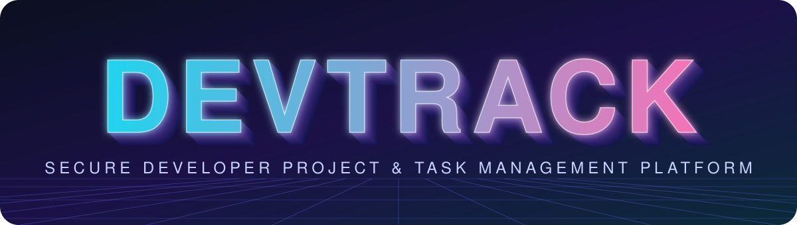
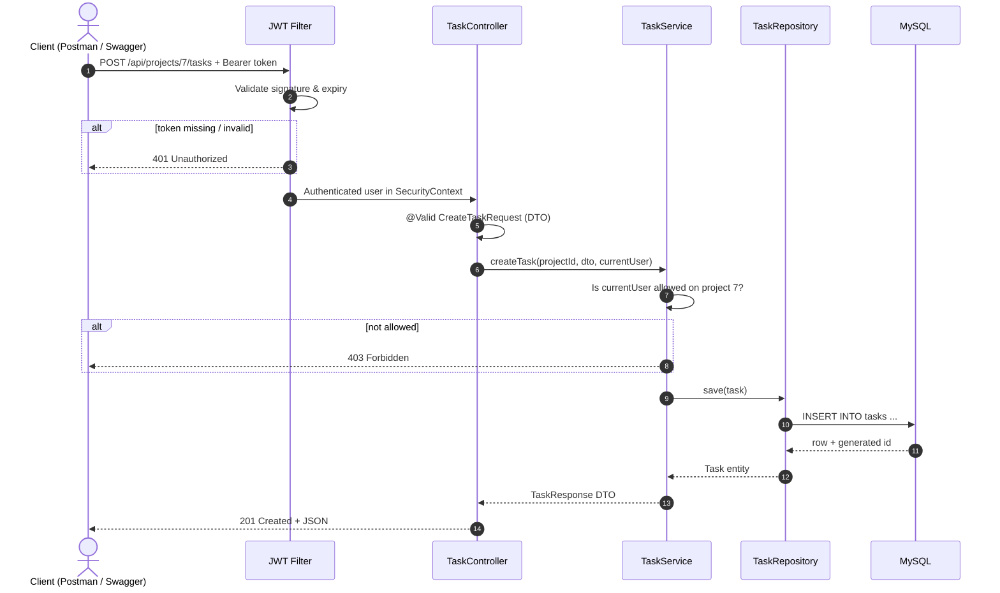
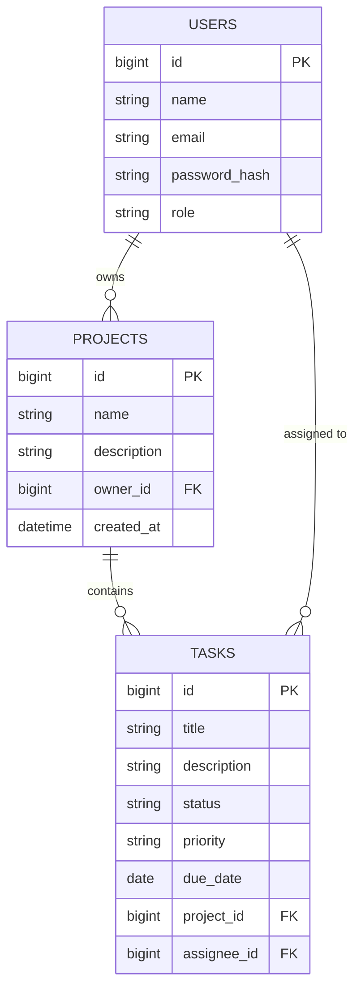
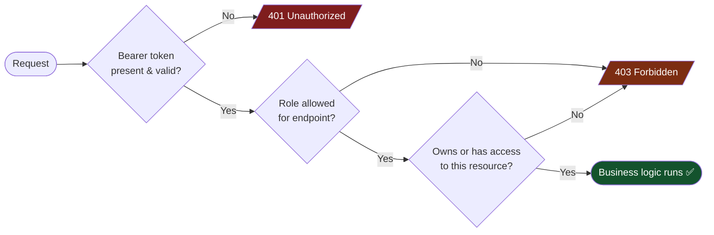
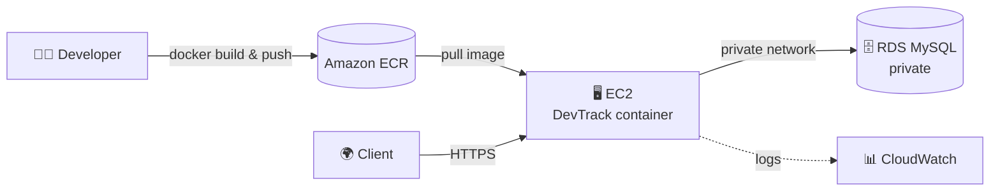

<div align="center">



<a href="https://github.com/Aditya152602/DevTrack">
  
</a>

<br/>


<h3>
  <a href="#-live-demo">🌐 Live Demo</a> &nbsp;•&nbsp;
  <a href="#-3d-architecture--exploded-view">🧊 3D Architecture</a> &nbsp;•&nbsp;
  <a href="#-api-reference">📡 API</a> &nbsp;•&nbsp;
  <a href="#-quick-start">⚡ Quick Start</a> &nbsp;•&nbsp;
  <a href="#-the-8-week-build-journey">🗺️ Build Journey</a>
</h3>

</div>

---

## 🎯 What is DevTrack?

> **DevTrack** is a production-style backend for managing developer **projects** and **tasks** — with real authentication, real authorization, a real database, containers, and a cloud deployment.

Most "task manager" demos stop at CRUD. DevTrack goes further and answers the questions a hiring manager actually asks:

| ❓ Question | ✅ DevTrack's answer |
|---|---|
| *Can you secure an API?* | JWT auth, BCrypt hashing, role checks, **per-user resource ownership** |
| *Can you design data?* | Normalized MySQL schema, JPA relationships, FK-enforced integrity |
| *Can you keep it reliable?* | DTOs, validation, global error handling, JUnit 5 + Mockito + integration tests |
| *Can you ship it?* | Dockerfile + Compose, deployed to AWS (EC2 + RDS), logs in CloudWatch |
| *Can you document it?* | Swagger/OpenAPI, architecture diagrams, CI pipeline |

> 🔐 **Security promise:** one user can **never** read or change another user's private projects by simply editing an ID in the URL.

---

## 🌐 Live Demo

| Resource | Link |
|---|---|
| ☁️ Hosting | **Deployed on AWS** — EC2 · RDS · ECR · CloudWatch — ✅ Live |
| 🚀 Live API | `https://<your-aws-endpoint>` *(paste your public EC2 / load-balancer URL)* |
| 📖 Swagger UI | `https://<your-aws-endpoint>/swagger-ui/index.html` |
| 🎥 Demo video | `<add link>` |

---

## 🧊 3D Architecture — Exploded View

Every request travels **down** this stack and the response travels back **up**.

<div align="center">
  
</div>

<br/>

<details>
<summary><b>🔬 Follow one request: <code>POST /api/projects/{id}/tasks</code></b> (click to expand)</summary>



</details>

---

## ✨ Features

<table>
<tr>
<td width="50%" valign="top">

### 🔐 Auth & Security
- Registration & login
- Passwords hashed with **BCrypt** (never plaintext)
- Signed **JWT** with expiry
- Role-based access checks
- **Resource ownership** enforcement
- Secrets via environment variables (never committed)

</td>
<td width="50%" valign="top">

### 📦 Projects & Tasks
- Create / list / view projects
- Add, list, update (`PATCH`), delete tasks
- Task **status**, **priority**, **due date**, **assignee**
- Pagination, sorting & filtering  
  `GET /api/tasks?status=TODO&page=0&size=10`

</td>
</tr>
<tr>
<td width="50%" valign="top">

### 🛡️ Robust API
- **DTOs** control exactly what goes in/out
- Bean Validation: `@Valid`, `@NotBlank`, `@Email`, `@Size`
- `@RestControllerAdvice` → one consistent error format
- Meaningful HTTP codes: `201` `400` `401` `403`

</td>
<td width="50%" valign="top">

### 🚢 Ship-ready
- Multi-stage-friendly **Dockerfile**
- **Docker Compose**: app + MySQL in one command
- AWS: **ECR → EC2**, managed **RDS MySQL**
- **CloudWatch** logs & basic monitoring
- **GitHub Actions** CI

</td>
</tr>
</table>

---

## 🧰 Tech Stack

<div align="center">


</div>

| Layer | Technology |
|---|---|
| Language | Java |
| Framework | Spring Boot, Spring Web, Spring Data JPA |
| Security | Spring Security, JWT, BCrypt |
| Database | MySQL (local) → AWS RDS (production) |
| Testing | JUnit 5, Mockito, integration tests |
| Docs | Swagger / OpenAPI |
| DevOps | Docker, Docker Compose, GitHub Actions |
| Cloud | AWS ECR, EC2, RDS, CloudWatch |
| Tools | IntelliJ IDEA, Postman, Git |

---

## 📡 API Reference

> Base path: `/api` &nbsp;|&nbsp; 🔓 = public &nbsp;|&nbsp; 🔒 = requires `Authorization: Bearer <JWT>`

| | Feature | Method & Endpoint | Purpose |
|:-:|---|---|---|
| 🔓 | Register | `POST /api/auth/register` | Create a user account |
| 🔓 | Login | `POST /api/auth/login` | Authenticate, receive JWT |
| 🔒 | Current user | `GET /api/users/me` | Logged-in user's profile |
| 🔒 | Create project | `POST /api/projects` | Create a project |
| 🔒 | List projects | `GET /api/projects` | Projects the user can access |
| 🔒 | Project details | `GET /api/projects/{id}` | One authorized project |
| 🔒 | Create task | `POST /api/projects/{id}/tasks` | Add a task to a project |
| 🔒 | List tasks | `GET /api/projects/{id}/tasks` | Tasks of a project |
| 🔒 | Update task | `PATCH /api/tasks/{id}` | Change status, priority, details |
| 🔒 | Delete task | `DELETE /api/tasks/{id}` | Delete an authorized task |

### 🚦 Status codes

| Code | Meaning | When |
|:-:|---|---|
| `201` | Created | Resource created successfully |
| `400` | Bad Request | Validation failed / malformed input |
| `401` | Unauthorized | Missing, expired or invalid token |
| `403` | Forbidden | Authenticated, but not allowed |

<details>
<summary><b>🧪 Try it with curl</b></summary>

```bash
# 1. Register
curl -X POST http://localhost:8080/api/auth/register \
  -H "Content-Type: application/json" \
  -d '{"name":"Aditya","email":"aditya@example.com","password":"StrongPass#123"}'

# 2. Login -> copy the token from the response
curl -X POST http://localhost:8080/api/auth/login \
  -H "Content-Type: application/json" \
  -d '{"email":"aditya@example.com","password":"StrongPass#123"}'

# 3. Call a protected endpoint
curl http://localhost:8080/api/users/me \
  -H "Authorization: Bearer <PASTE_TOKEN_HERE>"
```

> Adjust field names to match your actual DTOs.

</details>

---

## 🗄️ Database Design



- 👤 One **user** owns many **projects**
- 📁 One **project** contains many **tasks**
- 🎯 One **user** can be assigned many **tasks**
- JPA: `@ManyToOne` / `@OneToMany` — cascading is applied **deliberately**, not blindly

---

## 🔒 Security Model



- ✅ Passwords stored only as **BCrypt hashes**
- ✅ JWTs are **signed** and **expire**
- ✅ Ownership checked in the **service layer**, not just at the URL
- ✅ **No secrets in Git** — use environment variables

---

## ⚡ Quick Start

### Prerequisites
`Java 17+` · `Maven` · `Docker & Docker Compose` · `Git`

### Option A — 🐳 Docker Compose (recommended)

```bash
git clone https://github.com/Aditya152602/DevTrack.git
cd DevTrack

cp .env.example .env        # then edit values
docker compose up --build
```

API → `http://localhost:8080` &nbsp;|&nbsp; Swagger → `http://localhost:8080/swagger-ui/index.html`

### Option B — 💻 Run locally

```bash
# start a local MySQL (or use your own), then:
export DB_URL=jdbc:mysql://localhost:3306/devtrack
export DB_USERNAME=devtrack
export DB_PASSWORD=change_me
export JWT_SECRET=<long-random-secret>
export JWT_EXPIRATION_MS=3600000

./mvnw spring-boot:run
```

### 🔑 Environment variables

| Variable | Description |
|---|---|
| `DB_URL` | JDBC URL of MySQL |
| `DB_USERNAME` / `DB_PASSWORD` | Database credentials |
| `JWT_SECRET` | Signing key — **never commit this** |
| `JWT_EXPIRATION_MS` | Token lifetime |

> Match these names to your `application.properties` / `docker-compose.yml`.

---

## 🧪 Testing

```bash
./mvnw test
```

| Area | Verified |
|---|---|
| Authentication | Register, login, invalid credentials |
| Task creation | Happy path & persistence |
| Validation | Bad input → `400` with consistent error body |
| Access control | No token → `401`; other user's resource → `403` |

> 🧬 **Sanity rule:** break an important rule on purpose → tests **fail**; fix it → tests **pass**.

**Latest results:** `<paste test count / pass rate>` &nbsp;|&nbsp; **Perf baseline:** `<paste simple load-test numbers>`

---

## ☁️ Deployment (AWS)



- 🔐 RDS kept **private** — database port is never public
- 🧱 Security groups restrict network access
- 🗝️ Secrets stored securely, not in the repo
- 💸 Billing alerts set **before** provisioning

---

## 📁 Project Structure

```text
devtrack/
├── src/main/java/.../devtrack/
│   ├── controller/     # HTTP layer (REST endpoints)
│   ├── service/        # Business rules & ownership checks
│   ├── repository/     # Spring Data JPA repositories
│   ├── entity/         # User, Project, Task
│   ├── dto/            # Request / response models
│   ├── security/       # JWT filter, config, BCrypt
│   └── exception/      # @RestControllerAdvice handlers
├── src/test/           # Unit + integration tests
├── Dockerfile
├── docker-compose.yml
├── .env.example
└── .github/workflows/  # CI pipeline
```

> Adjust folder names to match your real package layout.

---

## 🗺️ The 8-Week Build Journey

> Built milestone by milestone — fundamentals first, features second.

| Week | Milestone | Deliverable | Status |
|:-:|---|---|:-:|
| 1 | ☕ Java & backend foundations | Console task manager | ✅ |
| 2 | 🌱 Spring Boot & first REST APIs | API tested in Postman | ✅ |
| 3 | 🗄️ MySQL, JPA & Hibernate | Data survives restarts | ✅ |
| 4 | 🔐 JWT auth & authorization | Protected endpoints, ownership rules | ✅ |
| 5 | 🛡️ Robust API & tests | DTOs, validation, pagination, JUnit/Mockito | ✅ |
| 6 | 🐳 Docker & reproducible setup | One-command local stack | ✅ |
| 7 | ☁️ AWS deployment | Live, remotely callable API | ✅ |
| 8 | ✨ Portfolio polish | Swagger, CI, docs, diagrams | ✅ |

> Update the Status column to match your real progress.

<details>
<summary><b>📖 Week-by-week details</b></summary>

**Week 1 — Java & backend foundations.** Classes/objects, OOP, collections, exceptions, basic SQL, Git.  
**Week 2 — Spring Boot REST.** `@RestController`, mappings, `@PathVariable`/`@RequestBody`, Controller → Service → Repository.  
**Week 3 — Persistence.** `@Entity`, `JpaRepository`, `@ManyToOne`/`@OneToMany`, MySQL config via env vars.  
**Week 4 — Security.** Filter chain, BCrypt, JWT signing/expiry, roles, ownership checks.  
**Week 5 — Quality.** DTOs, `@Valid`, global error handling, pagination/sorting/filtering, JUnit 5 + Mockito.  
**Week 6 — Containers.** Dockerfile, Compose, env config, logs/ports/networking.  
**Week 7 — Cloud.** ECR, EC2, RDS, security groups, CloudWatch, billing alerts.  
**Week 8 — Polish.** OpenAPI, architecture diagrams, CI, test evidence, design notes.

</details>

---

## 🧠 Design Decisions & Known Limitations

**Decisions**
- 🧱 **Monolith first** — a clean layered monolith beats premature microservices.
- 📨 **DTOs everywhere** — entities never leak straight to clients.
- 🧩 **Ownership in the service layer** — URL-level rules alone can't stop ID tampering.
- 🔁 **Deliberate cascading** — avoids accidental mass deletes.

**Known limitations / next steps**
- [ ] Team membership & shared projects
- [ ] Task comments
- [ ] Refresh tokens
- [ ] Rate limiting
- [ ] Caching hot reads

---

## 🤝 Contributing

1. Fork the repo
2. `git checkout -b feature/amazing-idea`
3. Commit with clear messages
4. Open a Pull Request

---

<div align="center">

### 👨‍💻 Built by **Aditya Dhar Dwivedi**

[](https://github.com/Aditya152602)
[](https://www.linkedin.com/in/dwivedi26)
[](https://aditya152602.github.io/Portfolio)

⭐ **If DevTrack impressed you, drop a star — it fuels the next build.** ⭐


</div>
