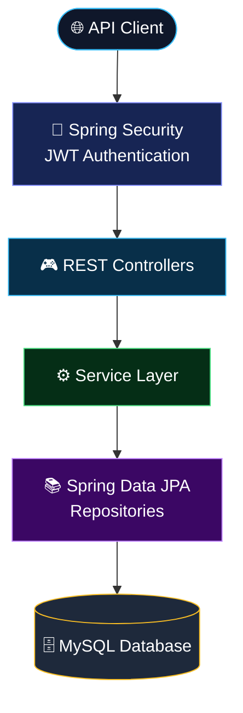

# 🚀 DevTrack — Engineering Teams, In Perfect Sync.

<p align="center">
  
</p>

<p align="center">
  <strong>A backend engineering project for collaborative task management, secure authentication, and team progress tracking.</strong>
</p>

<p align="center">
  
</p>

<p align="center">
  <a href="https://github.com/Aditya152602/DevTrack"></a>
  
  
  
</p>

<p align="center">
  
  
  
  
  
</p>

---

## ✨ The vision

**Great teams don't just complete tasks. They create momentum.**

DevTrack is a team-oriented task management backend designed to bring task assignment, progress visibility, and authenticated API access into one structured system.

Instead of treating tasks as disconnected records, DevTrack is being developed around a more useful question:

> How can a team understand what needs to be done, who is responsible, and how the overall work is progressing?

The goal is to build a practical, maintainable backend using the technologies and engineering practices used in modern Java applications.

## 🌌 Explore the system

| Capability | What it brings |
|---|---|
| 🔐 Authentication | Registration and login components with JWT-based authentication |
| 📋 Task management | REST endpoints for creating, retrieving, updating, and deleting tasks |
| 👥 Team workflows | Task assignment components and team-progress response models |
| 🗄️ Persistent storage | MySQL integration through Spring Data JPA and Hibernate |
| 🧪 Automated tests | Unit and integration test classes for backend behavior |
| 🐳 Containerization | Dockerfile and Docker Compose configuration for a container-based setup |

*Features listed here reflect the current project structure. Individual workflows and deployment configurations should be verified as development progresses.*

---

## 🧊 Architecture — a closer look

DevTrack follows a layered backend design. Each layer has a responsibility, making the code easier to understand, test, and extend.



### How a request travels

1. **Client** — sends an HTTP request to the API.
2. **Security** — protects secured routes using the configured authentication mechanism.
3. **Controller** — receives the request and coordinates the relevant operation.
4. **Service** — contains application and business logic.
5. **Repository** — communicates with persistent storage through Spring Data JPA.
6. **Database** — stores application records in MySQL.

The diagram represents the intended request flow; public routes, exception handling, and individual controller mappings can vary by endpoint.

---

## 🛠️ Technology stack

<p align="center">
  
</p>

| Technology | Purpose |
|---|---|
| Java | Application programming language |
| Spring Boot | Backend application framework |
| Spring Web | REST API development |
| Spring Security | Authentication and request security |
| JWT | Token-based authentication |
| Spring Data JPA | Database access and repository abstraction |
| Hibernate | Object-relational mapping |
| MySQL | Relational data storage |
| Maven | Dependency and build management |
| JUnit / Spring test tools | Automated testing |
| Docker / Compose | Container packaging and service configuration |
| Git and GitHub | Version control and source hosting |

---

## 🔌 API overview

DevTrack includes REST endpoints for task CRUD operations and authentication components.

### Task endpoints

The task collection uses `/api/tasks`.

| Method | Endpoint | Purpose |
|---|---|---|
| `GET` | `/api/tasks` | Retrieve tasks |
| `POST` | `/api/tasks` | Create a task |
| `PUT` | `/api/tasks/{id}` | Update an existing task |
| `DELETE` | `/api/tasks/{id}` | Delete a task |

Secured endpoints may require a valid bearer token, depending on the configured security rules.

### Example request

Create a task using a client such as Postman:

```http
POST /api/tasks
Content-Type: application/json
Authorization: Bearer <your-jwt-token>
```

Example JSON structure:

```json
{
  "title": "Build the task management API",
  "description": "Implement and test the task workflow"
}
```

Use the actual fields defined by the current request model when sending requests. The example illustrates the workflow, not a guarantee that every field is required or accepted.

### Authentication

The project includes registration and login request/response models, an authentication controller, a JWT service, and a JWT authentication filter.

Consult `AuthController.java` and `SecurityConfig.java` for the exact authentication URLs, public routes, token rules, and required request fields.

---

## ⚡ Getting started

### Prerequisites

Install the following before running the application locally:

- Java Development Kit compatible with the project configuration
- Maven, or use the included Maven Wrapper if one is added
- MySQL Server
- Git

### 1. Clone the repository

```bash
git clone https://github.com/Aditya152602/DevTrack.git
cd DevTrack
```

### 2. Create the database

Open your MySQL client and execute:

```sql
CREATE DATABASE IF NOT EXISTS devtrack_db;
```

Configure a dedicated database user with only the privileges the application needs. Avoid using the MySQL root account for routine application access.

### 3. Configure environment variables

The repository includes `.env.example` as a template. Create the actual environment configuration locally, or configure the variables in your IDE's run configuration.

Required values:

```dotenv
DB_USERNAME=your_database_username
DB_PASSWORD=your_database_password
JWT_SECRET=your_long_random_secret
```

For Docker Compose, also configure:

```dotenv
MYSQL_ROOT_PASSWORD=your_separate_root_password
```

Use unique secrets, keep `.env` out of Git, and never publish real passwords or JWT signing keys.

### 4. Run the Spring Boot application

The Maven project is located in the `devtrack/` directory:

```bash
cd devtrack
mvn spring-boot:run
```

If Maven is not installed, install it or add a Maven Wrapper to the project.

When startup succeeds, the application should listen on its configured port, typically `8080`.

### 5. Test the API

Use Postman or another HTTP client to test the task endpoints. Start with authentication if a route requires a token.

Check the application console for database connection errors, missing environment variables, and startup failures.

---

## 🐳 Docker deployment path

The repository contains a `Dockerfile`, `compose.yaml`, and `.dockerignore` to support a container-based setup.

From the repository root, the intended command is:

```bash
docker compose up --build
```

The Compose configuration is designed to run the backend alongside MySQL and use a persistent database volume.

**Before running this command:** verify that the Dockerfile copies the Maven project from `devtrack/`, because the `pom.xml` and `src/` directory are nested there rather than at the repository root. Also verify the environment variables and health-check configuration.

To stop the services:

```bash
docker compose down
```

To stop the services without deleting the persistent database volume, use the command above. Do not add `-v` unless you intentionally want to remove that volume and its stored data.

---

## 🧪 Testing and quality

The repository includes tests for application context loading, task service behavior, and task controller integration.

Run the test suite from the Maven project directory:

```bash
cd devtrack
mvn test
```

Use test results to validate changes before committing them. Integration tests that rely on MySQL or authentication should be configured with the correct test environment and credentials.

---

## 🗺️ Development roadmap

DevTrack is an evolving engineering project. The next milestones focus on correctness, security, maintainability, and deployment.

- [x] Task CRUD API foundation
- [x] Service and repository layers
- [x] Initial MySQL/JPA integration
- [x] JWT authentication components
- [x] Initial automated tests
- [x] Initial GitHub repository and commit
- [ ] Verify registration, login, token expiry, and protected routes end to end
- [ ] Enforce task ownership and team authorization consistently
- [ ] Strengthen validation and integration-test coverage
- [ ] Verify the complete Docker Compose workflow
- [ ] Add API documentation and example requests
- [ ] Deploy to a cloud environment
- [ ] Add CI checks for builds and tests

*The checklist records the intended development journey; checked items indicate the initial implementation work, not a claim of production readiness.*

---

## 🔒 Security principles

Security is more than adding a login endpoint.

- Store passwords using a strong password-hashing algorithm such as BCrypt.
- Keep JWT signing secrets outside source control.
- Validate input and return appropriate HTTP status codes.
- Enforce authorization on the server, not just in the user interface.
- Ensure users can access only the tasks and team data they're permitted to access.
- Use HTTPS in deployed environments.
- Avoid logging passwords, tokens, or other sensitive values.
- Rotate any credential that has been exposed.

JWT authentication alone does **not** provide end-to-end encryption. Any claim of end-to-end encryption would require a separately designed and verified encryption protocol.

---

## 🤝 Contributing

Suggestions, issues, and constructive feedback are welcome.

1. Fork the repository.
2. Create a feature branch.
3. Make a focused change.
4. Run the relevant tests.
5. Open a pull request describing the change and its verification.

For bugs, include reproducible steps and sanitized logs. Never include real credentials, access tokens, or personal data.

---

## 👨‍💻 About the developer

**Aditya Dhar Dwivedi**  
Computer Science Engineering · Artificial Intelligence, Algorithms & Machine Learning

Interested in backend engineering, algorithmic problem solving, scalable software, and AI-powered applications.

<p align="center">
  <a href="https://github.com/Aditya152602"></a>
  <a href="https://linkedin.com/in/dwivedi26/"></a>
  <a href="https://aditya152602.github.io/Portfolio/"></a>
</p>

---

<p align="center">
  <strong>Good software isn't just written. It's designed, tested, secured, and continuously improved.</strong>
  <br/>
  <sub>DevTrack · A journey toward better backend engineering.</sub>
</p>

<p align="center">
  
</p>
